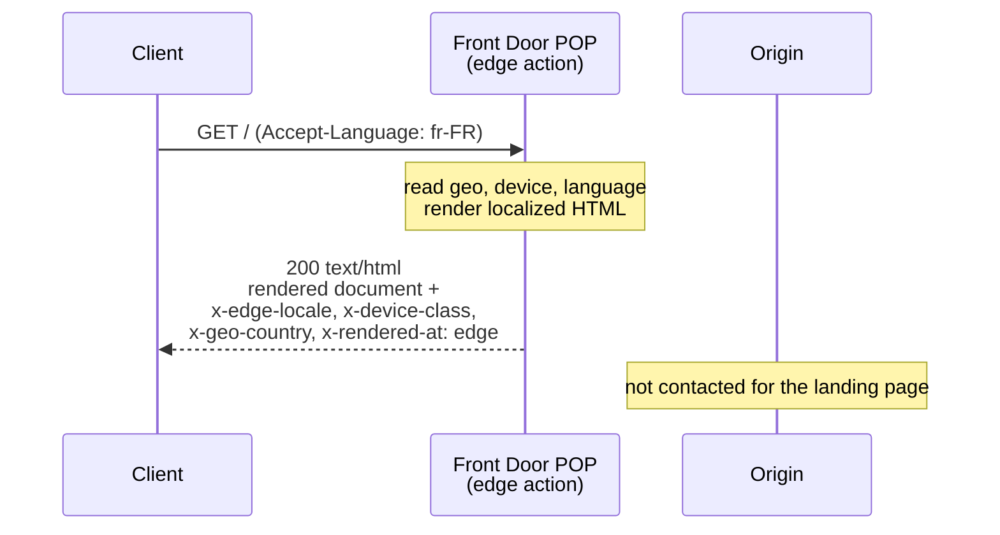

# SSR at the edge

An [Azure Front Door Edge Actions](https://learn.microsoft.com/azure/frontdoor/)
sample that **server-renders the landing page at the edge**. For each visitor it
reads **geo, device, and language** and returns a fully-rendered, localized HTML
document straight from the Front Door POP — no origin round trip.



## How it works

On `/` or `/index.html` the [handler](./edge_action.js):

1. Reads country (`context.country_code`), device (`context.is_mobile`) and
   language (`Accept-Language`).
2. Server-renders a localized, device-aware HTML page as a string.
3. Returns it with `response_code = 200`, `content-type: text/html`, and the
   rendered markup in `response.body` — so the visitor gets the page directly
   from the edge.

It also stamps `x-edge-locale`, `x-device-class`, `x-geo-country`,
`x-geo-region`, `x-rendered-at: edge` for observability. Other paths pass
through to the origin untouched.

Supported primitives used: response synthesis (`response.response_code` +
`response.body`) and header manipulation (`response.headers[...]`).

## Deploy

```bash
az login --tenant caglobaldemos2608.onmicrosoft.com
az extension add --name edge-action --upgrade
az extension add --name cdn --upgrade
```

**macOS / Linux:**

```bash
./deploy.sh
```

**Windows (PowerShell):**

```powershell
./deploy.ps1 -ResourceGroup myResourceGroup
```

Both scripts provision the edge action, the Front Door front end, and the
`EdgeAction` delivery rule that binds them. Edge propagation takes ~10–20 min.
Override defaults with environment variables (`deploy.sh`) or parameters
(`deploy.ps1`, e.g. `-EdgeActionName`, `-SubscriptionId`).

## Verify

```bash
HOST=$(az afd endpoint show -g rg-wachegha-edge-action-release \
  --profile-name ssrDemoAfd --endpoint-name ssrdemo --query hostName -o tsv)

# Headers: expect HTTP 200, content-type text/html, x-rendered-at: edge
curl -sD - -o /dev/null -H 'Accept-Language: fr-FR' "https://$HOST/" \
  | grep -iE 'HTTP/|content-type|x-rendered-at|x-geo-country|x-device-class|x-edge-locale'

# Body: the fully-rendered, localized HTML comes straight from the edge
curl -s -H 'Accept-Language: fr-FR' "https://$HOST/" | head -c 400
```

Expect a `200 text/html` response whose body is the localized page
(`<html lang="fr">`, "Bienvenue", ...) with `x-rendered-at: edge`. Change
`Accept-Language` (`es`, `de`, `en`) and the geo/device to see different
renders.

## Test locally

```bash
node -e 'const fs=require("fs");
const fn=new Function("console",fs.readFileSync("edge_action.js","utf8")+"\nreturn handler;")(console);
const r=fn(JSON.parse(fs.readFileSync("test_input.json"))).response;
console.log("status:",r.response_code,r.headers["content-type"]);
console.log(r.body);'
```

The golden input (FR mobile) renders the French landing page. See
[`test_expected.json`](./test_expected.json).

## Files

| File | Purpose |
| --- | --- |
| `edge_action.js` | The handler deployed to the edge |
| `deploy.sh` | Provision + bind everything (macOS/Linux) |
| `deploy.ps1` | Provision + bind everything (Windows/PowerShell) |
| `test_input.json` / `test_expected.json` | Golden local test |
| `edge_actions.d.ts` | Generated type definitions |
